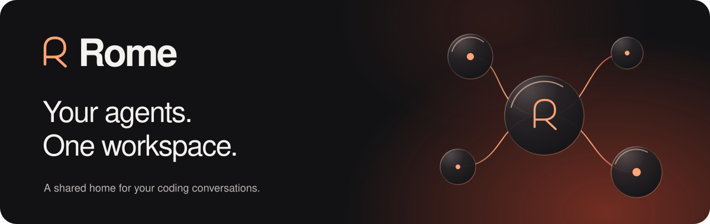
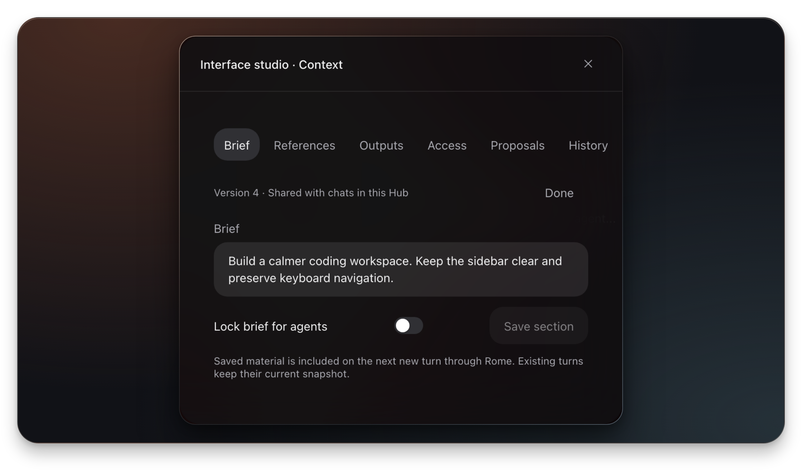
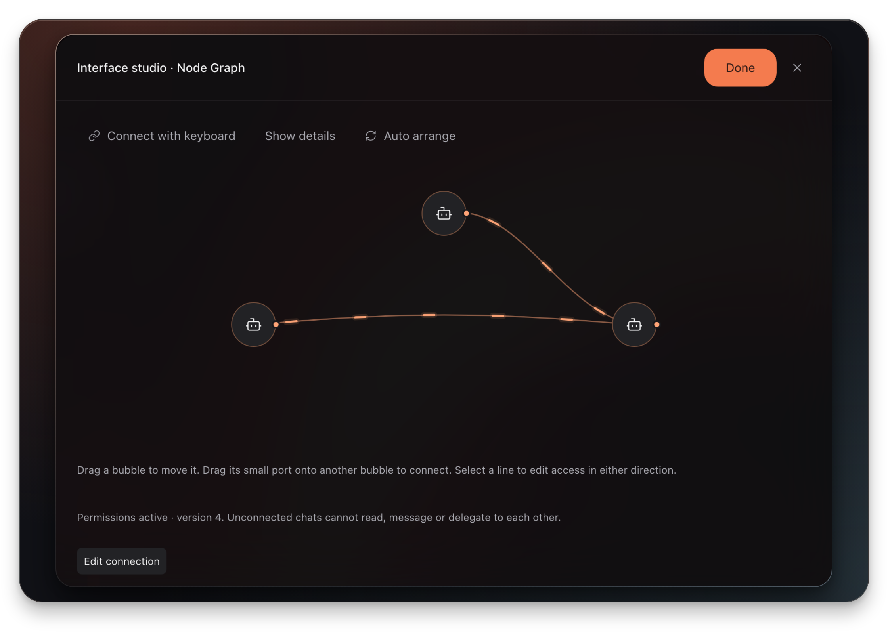
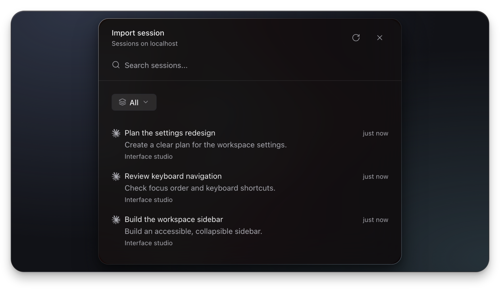
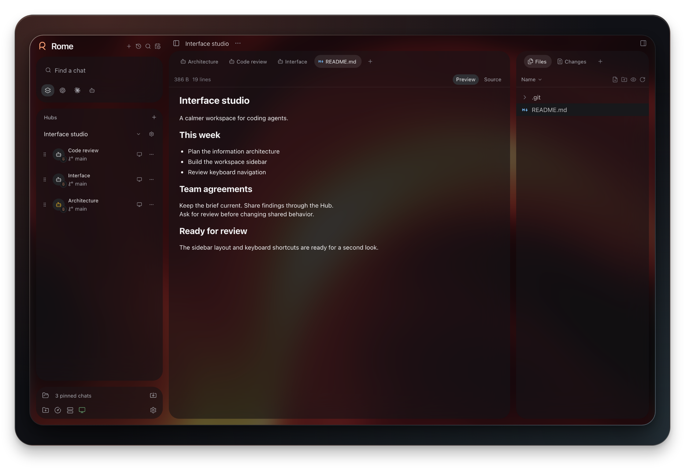

  

  <strong>Your AI apps, finally on speaking terms.</strong> 
  Bring coding conversations together. Share context. Stay in control.

  <a href="#install-rome">Install</a> &nbsp; / &nbsp;
  <a href="#a-workspace-built-around-your-chats">The workspace</a> &nbsp; / &nbsp;
  <a href="#an-early-preview-with-a-clear-direction">Preview notes</a> &nbsp; / &nbsp;
  <a href="https://github.com/t3knobox/rome-releases/releases">Releases</a>

## Install Rome

  

**v0.15.1-beta.22 · Apple Silicon · macOS 13 or later**

**Windows coming soon.**

[Release notes & checksums](https://github.com/t3knobox/rome-releases/releases/tag/v0.15.1-beta.22)

1. **Download** the DMG for your M-series Mac.
2. **Drag Rome into Applications**, then open it from there.
3. **Connect your coding agents** and bring your conversations into a Hub.

> This preview is not Apple-notarized. If macOS blocks the first launch, follow the steps below.

<strong>First launch: macOS won’t open Rome</strong>

After downloading from this repository:

1. Try opening **Rome** from **Applications**, then dismiss the warning.
2. Open **System Settings → Privacy & Security**.
3. Under **Security**, choose **Open Anyway** beside Rome.
4. Confirm with **Open** and authenticate if asked.

If the option is missing, try opening Rome again and return to Privacy & Security. [Apple’s guide](https://support.apple.com/en-sg/102445) explains the process. Once installed, you can eject the disk image.

<strong>Updates: check your version and get the next preview</strong>

Open **Settings → General → About** to see your version and source revision. Choose **Check for updates**, then **Install update & restart**.

**Automatic updates** are optional and off by default. Enable them to prepare updates in the background and install on quit. Existing Apple Silicon previews can update inside Rome.

## A workspace built around your chats

Give each agent a role. Keep the project’s context together. Decide how the conversations connect.

Actual Rome interface, shown with sample project and conversation data.

### Hubs

Keep related chats together, with a shared brief, references, and outputs your team of agents can maintain.

### Connection graph

Draw the connections. Set who can read history, send messages, or delegate—in either direction. Sharing a Hub alone doesn’t grant access.

### Native conversations

Find and continue existing coding-agent sessions where the provider supports it, using your installed agents and their accounts.

### Room to work

Chats, files, changes, terminals, and a browser in one workspace. Make it yours with dark and light themes and custom backgrounds.

### Different agents. Shared context.

Ask one agent to plan, another to review, and a third to build. Rome is being developed to connect that work to the original coding conversations, so you can move between your workspace and the agents’ own apps.

## An early preview with a clear direction

**Available now:** a Mac coding workspace with Hubs, shared material, connection controls, and provider-dependent native-session support.

**Still being developed:** cross-app chat mirroring and broader integration coverage. Session history and simultaneous control depend on each provider; opening a conversation in Rome does **not** guarantee it stays writable in another desktop app.

**Current scope:** Apple Silicon Macs and coding-agent conversations. Ordinary ChatGPT, Claude.ai, and Gemini consumer chats are excluded. Phone pairing is deferred.

---

<strong>About this repository</strong>

This is Rome’s official public home for installers, release notes, update files, and notices. There is no separate Rome website; any change will be announced here.

Application source and development history are maintained in a separate private repository. GitHub’s automatic **Source code** archives contain this download repository’s files, not the Rome application source.

<strong>Open-source acknowledgements</strong>

Rome is derived from [Paseo](https://github.com/getpaseo/paseo), copyright © 2025–present Mohamed Boudra, under the [Apache License 2.0](LICENSE). Third-party components retain their respective licenses.

